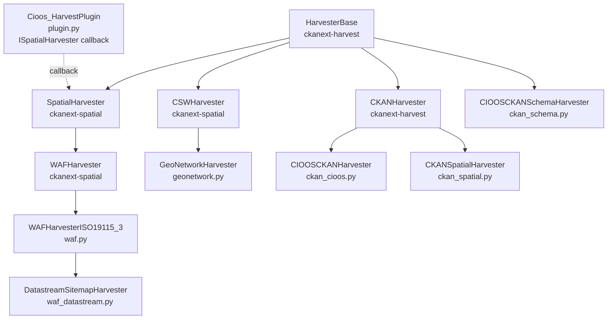
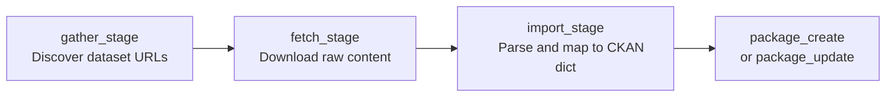
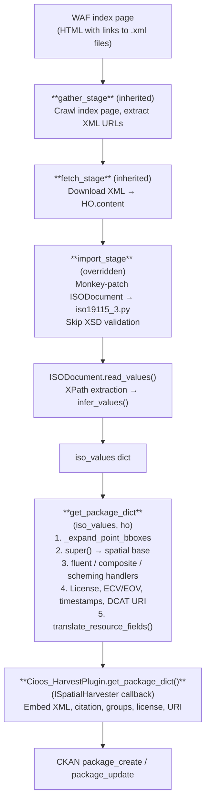
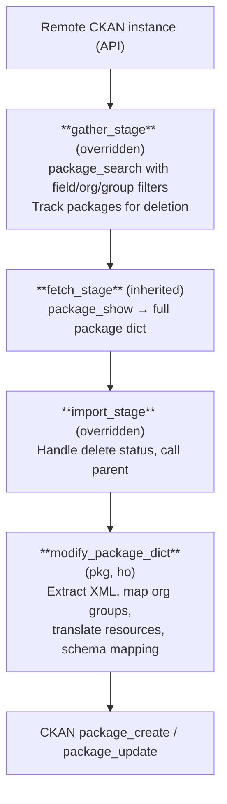

# ckanext-cioos_harvest

CIOOS-SIOOC harvest extension for CKAN. Extends `ckanext-harvest` and
`ckanext-spatial` with CIOOS-specific metadata handling for the
`scheming`, `fluent`, and `composite` extensions used by the CIOOS
data catalogue.

## What It Does

During the harvest import stage, the extension:

- Parses ISO 19115-3 XML metadata via a custom functional lxml
  parser (replacing ckanext-spatial's default ISO 19139 parser)
- Moves scheming fields from `extras` into the package root
- Ensures list and multi-list scheming field values are stored
  as lists rather than strings
- Places composite and composite-repeating fields into `__extras`
  where the composite extension expects them
- Flattens nested composite keys into concatenated field names
  (e.g. `{code: x}` becomes `field_code: x`)
- Converts fluent tag fields into `{lang: [values]}` dictionaries
- Populates fluent fields with the default language when no
  language dictionary is provided
- Matches and creates organizations and groups from harvested
  metadata (responsible organisations mapped to CKAN groups)
- Translates multilingual resource name/description fields

## Harvesters

This extension provides seven CKAN plugins — one ISpatialHarvester
callback plugin and six harvester types:

### ISpatialHarvester Plugin

| Plugin Name | Class | Description |
|---|---|---|
| `cioos_harvest` | `Cioos_HarvestPlugin` | ISpatialHarvester callback; post-processes spatial harvester results with CIOOS schema mapping |

### Harvester Plugins

| Plugin Name | Class | Source | Description |
|---|---|---|---|
| `waf_iso19115_3_harvester` | `WAFHarvesterISO19115_3` | `harvesters/waf.py` | Primary CIOOS harvester — WAF index of ISO 19115-3 XML files |
| `cioos_datastream_harvester` | `DatastreamSitemapHarvester` | `harvesters/waf_datastream.py` | DataStream ISO 19115-2 via sitemap.xml, with AWS Translate |
| `ckan_cioos_harvester` | `CIOOSCKANHarvester` | `harvesters/ckan_cioos.py` | CKAN-to-CKAN with field filtering, org matching by URI |
| `ckan_spatial_harvester` | `CKANSpatialHarvester` | `harvesters/ckan_spatial.py` | CKAN-to-CKAN filtered by spatial query (WKT polygon/bbox) via the remote's `spatial_query_geo` action |
| `ckan_schema_harvester` | `CIOOSCKANSchemaHarvester` | `harvesters/ckan_schema.py` | CKAN-to-CKAN without requiring a matching schema |
| `cioos_geonetwork_harvester` | `GeoNetworkHarvester` | `harvesters/geonetwork.py` | GeoNetwork CSW catalogue with topic-to-group mapping |

### Class Hierarchy



### Pipeline Stages

Every harvester implements three stages, run asynchronously via
the harvest queue:



1. **gather_stage** — Discovers datasets at the remote source;
   returns a list of `HarvestObject` IDs (one per dataset).
2. **fetch_stage** — Downloads the content for each
   `HarvestObject`; stores raw content in `HarvestObject.content`.
3. **import_stage** — Parses the content and creates/updates the
   CKAN package via `package_create` or `package_update`.

## File Structure

```
ckanext/cioos_harvest/
  plugin.py                  # Cioos_HarvestPlugin (ISpatialHarvester + IConfigurer + ITemplateHelpers)
  harvesters/
    __init__.py              # Re-exports all harvester classes
    base.py                  # Shared utilities, exceptions, singleton pattern
    field_handlers.py        # Unified fluent/composite/scheming field handlers
    waf.py                   # WAFHarvesterISO19115_3 (ISO 19115-3 WAF)
    waf_datastream.py        # DatastreamSitemapHarvester (DataStream ISO 19115-2)
    ckan_cioos.py            # CIOOSCKANHarvester (CKAN-to-CKAN)
    ckan_spatial.py          # CKANSpatialHarvester (CKAN + spatial filter)
    ckan_schema.py           # CIOOSCKANSchemaHarvester (schema-agnostic CKAN)
    geonetwork.py            # GeoNetworkHarvester (CSW/GeoNetwork)
  model/
    iso19115_3.py            # Functional lxml parser for ISO 19115-3 XML
  helpers.py                 # Template helper functions
  templates/                 # Harvest UI templates
  tests/
    test_iso19115_3.py       # Golden-file tests (XML → package dict)
    test_datastream.py       # DataStream harvester golden-file tests
    conftest.py              # Test configuration and fixtures
    fixtures/
      iso19115_3/
        00-xml/              # Input XML fixtures
        01-ckan-package/     # Expected package dict golden files
```

## Developer reference

### Harvesters in detail

### WAFHarvesterISO19115_3 (`waf.py`)

Harvests ISO 19115-3 XML files from a WAF (Web Accessible Folder) index page. This is the primary harvester for CIOOS Regional Association metadata.

**Data flow:**



**Key methods:**

| Method | Purpose |
|---|---|
| `info()` | Returns harvester name: `waf_iso19115_3_harvester` |
| `validate_config(config)` | Strips `validator_profiles` to skip XSD validation |
| `_validate_document(doc, ho)` | Always returns `(True, None, [])` — validation skipped |
| `import_stage(harvest_object)` | Monkey-patches ISODocument, cleans up HO extras |
| `_expand_point_bboxes(iso_values)` | Adds epsilon (~1m) to degenerate bboxes |
| `get_package_dict(iso_values, ho)` | Main schema-mapping pipeline (see data flow above) |
| `handle_fluent_harvest_dictionary()` | Delegates to `field_handlers.handle_fluent_field()` |
| `handle_composite_harvest_dictionary()` | Delegates to `field_handlers.handle_composite_field()` |
| `handle_scheming_harvest_dictionary()` | Delegates to `field_handlers.handle_scheming_field()` |

### DatastreamSitemapHarvester (`waf_datastream.py`)

Harvests DataStream ISO 19115-2 (`gmi:MI_Metadata`) datasets from a sitemap.xml. Adds AWS Translate auto-translation (en↔fr, credentials from the standard boto3 environment) and DataStream-specific DOI handling.

**Key differences from parent (WAFHarvesterISO19115_3):**
- Overrides `gather_stage` — parses sitemap.xml instead of WAF index page
- Overrides `import_stage` — bypasses the ISO 19115-3 monkey-patch (uses standard `ISODocument`)
- Translates title, abstract, and keywords via AWS Translate, cached in Redis under `awsTranslations_<src>_to_<tgt>`
- Normalises bare DOI paths to `https://doi.org/...` URLs
- Resolves license from `gmd:useLimitation` (free-text URL) instead of `gmd:useConstraints`
- Creates a single "Access DataStream" resource per dataset

**Key methods:**

| Method | Purpose |
|---|---|
| `info()` | Returns harvester name: `datastream_sitemap` |
| `gather_stage(harvest_job)` | Parses sitemap.xml, tracks new/changed/deleted by last-modified date |
| `import_stage(harvest_object)` | Calls `WAFHarvester.import_stage()` directly (skips ISO 19115-3 monkey-patch) |
| `translate_string(redis_conn, text, src, tgt)` | AWS Translate with Redis cache |
| `_extract_use_limitation_url(ho)` | Parses license URL from `gmd:useLimitation` |
| `_lookup_license_by_url(url)` | Reverse-lookup license_id from CKAN register or `ckan_license.json` |
| `_normalise_doi_url(identifier)` | Converts bare DOI → `https://doi.org/...` |
| `_parse_cited_responsible_party(ho)` | Extracts authors from `gmd:citedResponsibleParty` XML |
| `get_package_dict(iso_values, ho)` | 14-step pipeline: translate → super() → cleanup → license → keywords |

### CIOOSCKANHarvester (`ckan_cioos.py`)

Harvests from a remote CKAN instance via the CKAN API. Supports field filtering, organisation matching by URI, and deletion tracking.

**Data flow:**



**Key methods:**

| Method | Purpose |
|---|---|
| `info()` | Returns harvester name: `ckan_cioos` |
| `validate_config(config)` | Ensures `field_filter_include`/`exclude` aren't both set |
| `gather_stage(harvest_job)` | Remote search with field/org/group filtering, deletion tracking |
| `import_stage(harvest_object)` | Handles delete status |
| `modify_remote_organization(id, pkg, ctx)` | Matches orgs by `organization-uri` code or name |
| `modify_package_dict(pkg, ho)` | Schema mapping, group handling, resource translation |

### CKANSpatialHarvester (`ckan_spatial.py`)

Harvests from a remote CKAN instance, filtering datasets by a spatial query (WKT polygon or bounding box) against the remote instance's spatial search API.

**Key methods:**

| Method | Purpose |
|---|---|
| `info()` | Returns harvester name: `ckan_spatial` |
| `_post_content(url, params)` | POST to remote spatial search API with optional API key |
| `modify_package_dict(pkg, ho)` | Sets default projects/datacentre, adds site catalogue entry |
| `modify_search(pkg_dicts, url, fq)` | Filters packages by spatial query via `/api/2/search/dataset/geo` |

**Configuration:** Requires `spatial_filter` (WKT string) or `spatial_filter_file` (path to WKT file) in harvest source config.

### CIOOSCKANSchemaHarvester (`ckan_schema.py`)

Harvests from a remote CKAN instance without requiring a matching schema. Useful for harvesting datasets from non-CIOOS CKAN instances.

**Key differences from CIOOSCKANHarvester:**
- Extends `HarvesterBase` directly (not `CKANHarvester`)
- Fetches full package JSON during `gather_stage` (no separate `fetch_stage`)
- Supports `default_tags`, `default_groups`, `default_extras` config
- Supports `remote_orgs`/`remote_groups` = `"create"` to auto-create missing orgs/groups
- License mapping via `license_mapping` config dict

**Key methods:**

| Method | Purpose |
|---|---|
| `info()` | Returns harvester name: `ckan_schema` |
| `validate_config(config)` | Validates api_version, default_tags, org/group filters, etc. |
| `gather_stage(harvest_job)` | Paginated remote search, stores full JSON in HarvestObject |
| `fetch_stage(harvest_object)` | No-op (content already fetched in gather) |
| `import_stage(harvest_object)` | Applies defaults, validates orgs/groups, maps schema fields |

### GeoNetworkHarvester (`geonetwork.py`)

Harvests from a GeoNetwork CSW (Catalogue Service for the Web) server. Extends ckanext-spatial's `CSWHarvester`.

**Key methods:**

| Method | Purpose |
|---|---|
| `info()` | Returns harvester name: `geonetwork` |
| `get_package_dict(iso_values, ho)` | Adds GeoNetwork URLs, topic→group mapping, temporal-extent-instant, WMS format fix |
| `infer_timeinstants(values)` | Extracts temporal-extent-instant values |
| `handle_groups(ho, mapping, url, vals)` | Maps ISO topic-categories to CKAN groups |
| `fix_resource_type(resources)` | Sets format=`wms` when protocol contains `OGC:WMS` |

### Shared utilities (`base.py`)

| Function | Purpose |
|---|---|
| `singleton_new(cls)` | `__new__` for singleton harvesters — all harvesters use `__new__ = singleton_new` |
| `load_json(val)` | Eagerly decode any JSON string |
| `from_json(val)` | Conservative decode — only `{`/`[`-prefixed strings (safe for bbox floats) |
| `get_object_extra(ho, key)` | Retrieve single `HarvestObject` extra by key |
| `get_extra(key, pkg)` | Find extra dict in `package_dict["extras"]` by key |
| `flatten_composite_keys(obj)` | Recursively flatten nested dicts, joining keys with `_` |
| `sanitize_tag(text)` | Replace/strip characters rejected by CKAN tag validator |
| `extract_xml_from_harvest_object(pkg, ho)` | Extract XML from HO content or fetch from URL |
| `handle_groups(ctx, ho, mapping, type, cats)` | Create/find CKAN groups for responsible organisations |
| `make_site_catalogue_entry()` | Build catalogue dict from CKAN site config |
| `deduplicate_catalogue_entries(entries)` | Deduplicate by URL, preserving order |
| `translate_resource_fields(resources, lang)` | Decode multilingual resource name/description into `_translated` dicts |
| `all_packages_for_source(source_id)` | Fetch all packages from a harvest source (paginated) |

### Shared field handlers (`field_handlers.py`)

Three unified functions parameterised for both the WAF and plugin.py code paths:

| Handler | Matches | Key behaviour |
|---|---|---|
| `handle_fluent_field()` | `fluent_text` / `fluent_tags` preset fields | Expects `{lang: value}` dicts; falls back to wrapping scalars in `{default_lang: value}`. WAF path always sanitizes tags; plugin path only when `clean_tags=True`. |
| `handle_composite_field()` | `composite` / `composite_repeating` preset fields | Calls `flatten_composite_keys()` — joins nested keys with `_`. WAF path uses `separator="\|"` and writes to `__extras` (1-indexed); plugin path uses `scheming_composite_separator()` and writes to `package_dict` directly. |
| `handle_scheming_field()` | All remaining schema fields | Moves matching keys from extras/iso_values to `package_dict`; decodes JSON-encoded values via `from_json()`. |

### Cioos_HarvestPlugin ISpatialHarvester callback (`plugin.py`)

`Cioos_HarvestPlugin` implements the `ISpatialHarvester` interface. Its `get_package_dict()` method runs **after** any spatial harvester's own `get_package_dict()` as a post-processing callback. This applies to both `WAFHarvesterISO19115_3` and `GeoNetworkHarvester`.

**Responsibilities:**
- Embed raw XML as `harvest_document_content` extra
- Populate harvest source metadata extras
- Set `license_id` from `use-constraints`
- Build bilingual `citation` dict (CSL-JSON with CKAN URLs)
- Generate DCAT `uri` from `unique-resource-identifier-full`
- Iterate schema fields via the shared field handlers
- Populate `projects`, `datacentre`, `lineage`, `included_in_data_catalogue`
- Set `title_translation_method`, `notes_translation_method`, `keywords_translation_method`
- Map responsible organisations to CKAN groups (type=`resorg`)
- Translate resource name/description to `_translated` dicts
- Guess resource format from URL (ERDDAP, OBIS, file extensions)

### ISO 19115-3 namespace map

CIOOS ISO 19115-3 documents (waf.forms.cioos.ca) use these URIs — **not** the ISO 19139 URIs used by ckanext-spatial's base classes:

| Prefix | URI |
|---|---|
| `mdb` | `http://standards.iso.org/iso/19115/-3/mdb/2.0` |
| `cit` | `http://standards.iso.org/iso/19115/-3/cit/2.0` |
| `mri` | `http://standards.iso.org/iso/19115/-3/mri/1.0` |
| `gex` | `http://standards.iso.org/iso/19115/-3/gex/1.0` |
| `mcc` | `http://standards.iso.org/iso/19115/-3/mcc/1.0` |
| `gco` | `http://standards.iso.org/iso/19115/-3/gco/1.0` (**differs** from ISO 19139) |
| `gml32` | `http://www.opengis.net/gml/3.2` |
| `mrl` | `http://standards.iso.org/iso/19115/-3/mrl/1.0` |

## Requirements

- CKAN 2.12
- ckanext-harvest, ckanext-spatial, ckanext-scheming, ckanext-fluent
- the `cioos` plugin ([`ckanext.cioos`](https://github.com/cioos-siooc/ckanext-cioos_theme/tree/development-2-12/ckanext/cioos),
  shipped by ckanext-cioos_theme): the harvesters use its helpers (fully-qualified URIs, licences) and
  the `ckan_spatial` harvester queries its `spatial_query_geo` action on the
  remote catalogue

## Configuration

### ckan.ini

Set timeout for `request.get` when reading full XML body from a
URL (used by the CIOOS CKAN harvester):

```ini
ckan.index_xml_url_read_timeout = 500
```

### Harvest Source Config

Per-source configuration is set as JSON in the harvest source
configuration field. All fields are optional.

**Common options (all harvesters):**

```json
{
  "url_read_timeout": 500,
  "clean_tags": false,
  "organization_mapping": {},
  "data_catalogue_source": []
}
```

**CIOOSCKANHarvester additional options:**

```json
{
  "field_filter_include": ["field1", "field2"],
  "field_filter_exclude": ["field3"],
  "api_key": "your-api-key"
}
```

Note: `field_filter_include` and `field_filter_exclude` are mutually
exclusive.

**CKANSpatialHarvester additional options:**

```json
{
  "spatial_filter": "POLYGON((...)) or BOX(...)",
  "spatial_filter_file": "/path/to/wkt/file",
  "spatial_crs": 4326
}
```

## Installation

In [cioos-ckan-docker-base](https://github.com/cioos-siooc/cioos-ckan-docker-base)
this extension is a submodule under `src/`; the image installs it and its
dependencies (declared in `pyproject.toml`, locked in that repo's
`requirements.txt`).

For manual installation:

1. Activate your CKAN virtual environment
2. Install the package:

   ```shell
   pip install -e .
   ```

3. Add the plugins to `ckan.plugins` in your CKAN config:

   ```ini
   ckan.plugins = ... cioos_harvest waf_iso19115_3_harvester ckan_cioos_harvester
   ```

4. Restart CKAN

## Running Tests

Tests require the full CKAN stack (PostgreSQL, Solr, Redis). From
cioos-ckan-docker-base, against the running dev stack:

```bash
# Run all harvester tests
just test-harvest -vv

# Run only parser tests (XML parsing)
just test-harvest -vv -k parser

# Run only package dict tests (full pipeline)
just test-harvest -vv -k package

# Regenerate golden files after intentional pipeline changes
just test-harvest --regenerate-fixtures
```

CI runs them against the production image (`just smoke-test`).

Golden files live in `ckanext/cioos_harvest/tests/fixtures/`. If a JSON file
is missing, the test auto-generates it and skips; review the file
then re-run to validate.

## License

AGPL v3.0 or later
